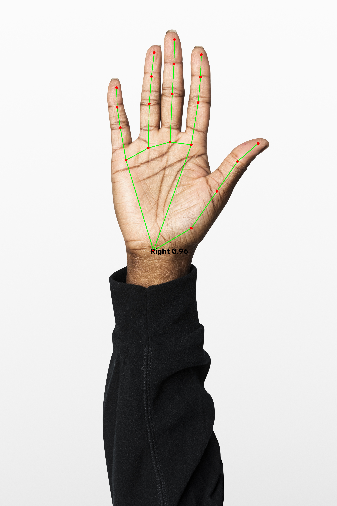
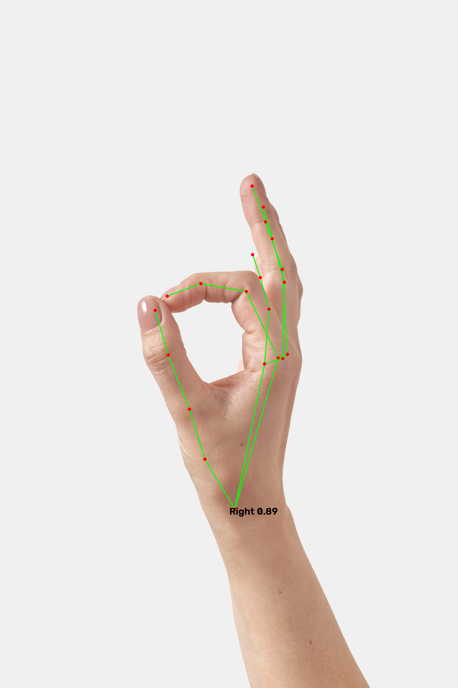
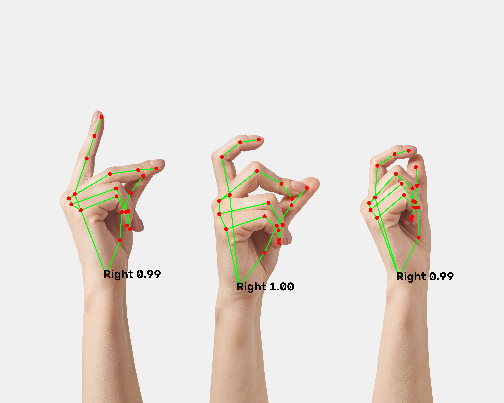

# hand-recognizer

Hand landmark detection with [MediaPipe Hand Landmarker](https://developers.google.com/edge/mediapipe/solutions/vision/hand_landmarker/python) and OpenCV. It finds hands in webcam video or still images and draws the 21 landmarks and the hand skeleton on them.

## Requirements

- macOS, Linux or Windows
- [uv](https://docs.astral.sh/uv/) (it installs the right Python version for you)
- A webcam, for live tracking

> **Uses MediaPipe's current Tasks API** (`HandLandmarker`), not the deprecated `mp.solutions.hands` found in most older tutorials.
>
> **Last verified:** November 2026 with Python 3.12.16, mediapipe 1.2.3 and opencv-python 5.0.0 on macOS (M5 Apple Silicon). Exact versions are pinned in `uv.lock`, so `uv sync` reproduces this setup.

## Old API vs new API

Most tutorials online use the legacy Solutions API. Depending on your MediaPipe version, it may not work at all. This project uses the Tasks API instead.

**Legacy (`mp.solutions.hands`), avoid:**

```python
import mediapipe as mp

hands = mp.solutions.hands.Hands(
    static_image_mode=False,
    max_num_hands=2,
    min_detection_confidence=0.5,
)
results = hands.process(rgb_frame)
for hand in results.multi_hand_landmarks or []:
    ...
```

**Current Tasks API (`HandLandmarker`), used here:**

```python
import mediapipe as mp
from mediapipe.tasks import python
from mediapipe.tasks.python import vision

options = vision.HandLandmarkerOptions(
    base_options=python.BaseOptions(model_asset_path="models/hand_landmarker.task"),
    running_mode=vision.RunningMode.VIDEO,
    num_hands=2,
    min_hand_detection_confidence=0.5,
)
with vision.HandLandmarker.create_from_options(options) as landmarker:
    mp_image = mp.Image(image_format=mp.ImageFormat.SRGB, data=rgb_frame)
    result = landmarker.detect_for_video(mp_image, timestamp_ms)
    for hand in result.hand_landmarks:
        ...
```

| | Legacy Solutions API | Tasks API |
| --- | --- | --- |
| Import | `mediapipe.solutions` | `mediapipe.tasks.python.vision` |
| Model | Built into the package | Separate `.task` file you download |
| Video setting | `static_image_mode=False` | `running_mode=RunningMode.VIDEO` |
| Max hands | `max_num_hands` | `num_hands` |
| Detection confidence | `min_detection_confidence` | `min_hand_detection_confidence` |
| Run on a frame | `hands.process(frame)` | `detect()`, `detect_for_video()` or `detect_async()` |
| Landmarks | `results.multi_hand_landmarks` | `result.hand_landmarks` |
| Drawing | `mp.solutions.drawing_utils` | Your own OpenCV drawing |

**Quick check:** if the code you're copying has `solutions` in its imports, it uses the legacy API.

## Results

| Open palm | Posing | Three hands |
| --- | --- | --- |
|  |  |  |

## Setup

1. **Clone the repository**

   ```bash
   git clone https://github.com/RoshanBaluTMB/hand-recognizer.git
   cd hand-recognizer
   ```

2. **Install uv** (skip if you already have it)

   ```bash
   curl -LsSf https://astral.sh/uv/install.sh | sh
   ```

3. **Install the dependencies**

   ```bash
   uv sync
   ```

   This creates a `.venv` folder in the project and installs the exact versions recorded in `uv.lock`.

4. **Download the hand model**

   ```bash
   mkdir -p models
   curl -L -o models/hand_landmarker.task \
     https://storage.googleapis.com/mediapipe-models/hand_landmarker/hand_landmarker/float16/latest/hand_landmarker.task
   ```

## Run

From the project folder (runs in default mode):

```bash
uv run python src/main.py
```
## Usage

Run from the project folder. Pick one mode:

| Mode | Command | What it does |
| --- | --- | --- |
| Images (default) | `uv run python src/main.py` or  `uv run python src/main.py --image` | Detects hands in every image in `samples/` |
| Video | `uv run python src/main.py --video` | Processes `samples/sample.mp4` |
| Live | `uv run python src/main.py --live` | Tracks hands from the webcam |

- Press `q` to stop the video or webcam window, or any key to close an image window.
- On macOS, allow camera access for Terminal (or VS Code) when asked.
- Run `uv run python src/main.py --help` to see all options.

## Project structure

```text
hand-recognizer/
├── models/            # hand_landmarker.task (downloaded, not in Git)
├── results/           # stock image results
├── samples/           # stock images/videos
├── src/
│   └── main.py        # detection and drawing
├── pyproject.toml     # dependencies
└── uv.lock            # exact dependency versions
```
## Sample media credits

The images and videos in `samples/` are either recorded by the author or free stock media.

| File | Source |
| --- | --- |
|`sample/*.jpg` | Images from [MotionArray](https://motionarray.com/stock-video/?q=hands)
| `samples/sample_video.mp4` | Video by [cottonbro studio](https://www.pexels.com/video/a-footage-of-moving-hands-6752666/) on Pexels |